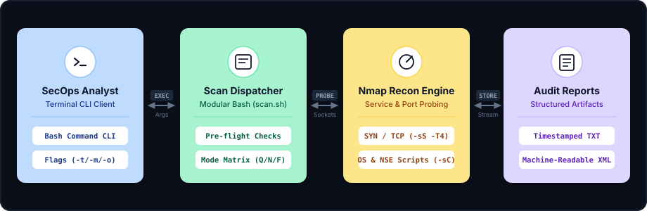

# Automated Network Reconnaissance Tool

<div align="center">
  

  [](https://www.gnu.org/software/bash/)
  [](https://nmap.org/)
  [](https://www.kernel.org/)
  [](https://www.shellcheck.net/)
  [](LICENSE)
</div>

---

## 📌 Executive Overview

The **Automated Network Reconnaissance Tool** is an automated network security auditing and host enumeration utility developed in GNU Bash and powered by Nmap. Built for cybersecurity engineers, penetration testers, and network administrators, it transforms complex multi-step reconnaissance tasks into consistent, scriptable command invocations.

Operating with zero runtime dependencies beyond Bash and Nmap, the utility automates alive-host discovery, TCP/UDP port mapping, OS fingerprinting, and service version detection while saving synchronized output into human-readable plaintext logs and machine-parseable XML.

---

## 🏛️ System Architecture Flow

```
+------------------------------------------------------------------------------------------------------------------------+
|                                    Automated Network Reconnaissance Architecture Flow                                  |
+--------------------------+          +-------------------------+          +-----------------------+          +----------+
|  SecOps Analyst          |   EXEC   |  Scan Dispatcher        |  PROBE   |   Nmap Recon Engine   |  STORE   |Structured|
|  (Terminal CLI Client)   | <======> |  (Modular Bash scan.sh) | <======> |   (Raw Sockets & NSE) | <======> |Audit Log |
|  - Flags (-t / -m / -o)  |   Args   |  - Pre-flight & Modes   | Sockets  |   - SYN/TCP, OS & NSE |  Stream  |TXT & XML |
+--------------------------+          +-------------------------+          +-----------------------+          +----------+
```

<p align="center" style="margin: 20px 0;">
  
</p>

* **SecOps Analyst (Terminal CLI Client)**: Operator terminal interface supporting dynamic target flags (`-t`), scan modes (`-m`), and output paths (`-o`).
* **Scan Dispatcher (Modular Bash / scan.sh)**: Pre-flight permission validator, CIDR subnet parser, and multi-tier mode routing matrix (Quick, Normal, Full).
* **Nmap Recon Engine (Service & Port Probing)**: High-performance TCP SYN stealth scanning (`-sS`), OS fingerprinting (`-O`), and NSE vulnerability scripts (`-sC`).
* **Audit Reports (Structured Artifacts)**: Timestamped plaintext human-readable summaries and machine-parsable XML reports stored in `scans/`.

---

## 📚 Complete Engineering Documentation

The repository features a complete 6-file engineering specification suite located in the [`docs/`](./docs) directory:

| Document | Description | Status |
|---|---|---|
| 📄 **[PRD.md](./docs/PRD.md)** | Product Requirements Document: Vision, target personas, KPIs, functional and non-functional specifications. | `Complete` |
| 🏗️ **[ARCHITECTURE.md](./docs/ARCHITECTURE.md)** | Architectural topology, component pipeline, scan modes matrix, and ADRs. | `Complete` |
| 🛡️ **[RULES.md](./docs/RULES.md)** | Engineering standards: ShellCheck compliance, variable quoting, signal traps, and secure logging. | `Complete` |
| 🎨 **[DESIGN.md](./docs/DESIGN.md)** | Terminal UX design, color palette tokens, typography, ASCII banners, and telemetry layout. | `Complete` |
| 📋 **[TASKS.md](./docs/TASKS.md)** | Engineering task breakdown across 4 phases (20 deliverables completed) with clean status tracking. | `Complete` |
| 🧠 **[MEMORY.md](./docs/MEMORY.md)** | Operational invariants, security guardrails, completed milestones, and knowledge base tracking. | `Complete` |

---

## ✨ Key Features & Scan Capabilities

- **Standardized Multi-Tier Scanning:**
  - `quick`: High-speed SYN scan targeting top 100 ports using aggressive timing (`-F -T4`).
  - `normal`: Comprehensive top 1,000 TCP port scan with ICMP ping sweep and service banner grabbing (`-sV`).
  - `full`: Exhaustive 65,535-port audit (`-p-`), operating system detection (`-O`), and default NSE script execution (`-sC`).
- **Dual-Stream Telemetry:** Real-time terminal output streaming while simultaneously persisting to a timestamped file via `tee`.
- **SIEM-Ready XML Export:** Option to generate structured `-oX` XML reports for automated vulnerability ingestion pipelines.
- **Robust POSIX CLI:** Full support for both short (`-t`, `-m`, `-o`, `-h`) and long (`--target`, `--mode`, `--output`, `--help`) argument syntax.
- **Fail-Safe Pre-flight Checks:** Verifies argument validity, network target specifications, and binary dependencies prior to scanning.

---

## 🛠️ Scan Modes Matrix

| Mode Flag | Port Scope | Timing | Probes & Detection | Primary Objective |
|---|---|---|---|---|
| `quick` | Top 100 Ports | `-T4` | Fast TCP SYN / Connect | Rapid alive-host triage |
| `normal` | Top 1,000 Ports | `-T3` | ICMP + TCP + Service Version | Standard perimeter assessment |
| `full` | All 65,535 Ports | `-T4` | TCP SYN + OS Fingerprint + NSE Scripts | Comprehensive penetration testing audit |

---

## 🚀 Quickstart & Usage Guide

### Prerequisites
- GNU Bash 4.0 or higher
- Nmap 7.x or higher installed and available in `$PATH`
- Linux, macOS, or Unix-like environment

### 1. Clone & Set Permissions
```bash
git clone https://github.com/abhishek4643/Nmap-Project.git
cd Nmap-Project
chmod +x scan.sh example_usage.sh
```

### 2. Basic Invocations
```bash
# Display help and argument reference
./scan.sh -h

# Quick scan on a local host
./scan.sh -t 192.168.1.1 -m quick

# Normal scan on a domain with default TXT output
./scan.sh -t example.com -m normal

# Full deep scan with machine-readable XML output (requires sudo for raw sockets)
sudo ./scan.sh -t 192.168.1.100 -m full -o xml
```

---

## 📂 Directory Structure

```
Nmap-Project/
├── docs/                           # Complete Engineering Documentation Suite
│   ├── architecture.svg            # Responsive pastel architecture flow card
│   ├── palette.svg                 # Visual 8-color design palette card
│   ├── principles.svg              # 4-card design principles vector card
│   ├── PRD.md                      # Product Requirements Document
│   ├── ARCHITECTURE.md             # System Architecture Specifications
│   ├── RULES.md                    # Engineering Rules & Scripting Standards
│   ├── DESIGN.md                   # Design System & CLI Specifications
│   ├── TASKS.md                    # Engineering Checklist & Tasks
│   └── MEMORY.md                   # System Memory & Context State
├── example_usage.sh                # Automated example execution scenarios
├── LICENSE                         # MIT License
├── README.md                       # Master Repository Overview
├── RUNNING_INSTRUCTIONS.txt        # Detailed execution and environment instructions
└── scan.sh                         # Main automated reconnaissance script
```

---

## 👤 Author & Contact

**Abhishek Perumalla**
- **Email:** [abhishekp.perumalla@gmail.com](mailto:abhishekp.perumalla@gmail.com)
- **Phone:** +91-8919415774
- **Location:** Hyderabad, India
- **Portfolio:** [https://portfolio-three-omega-ahkmg9l6l4.vercel.app/](https://portfolio-three-omega-ahkmg9l6l4.vercel.app/)
- **GitHub:** [https://github.com/abhishek4643](https://github.com/abhishek4643)
- **LinkedIn:** [https://www.linkedin.com/in/abhishek-perumalla-a1ab57251](https://www.linkedin.com/in/abhishek-perumalla-a1ab57251)
