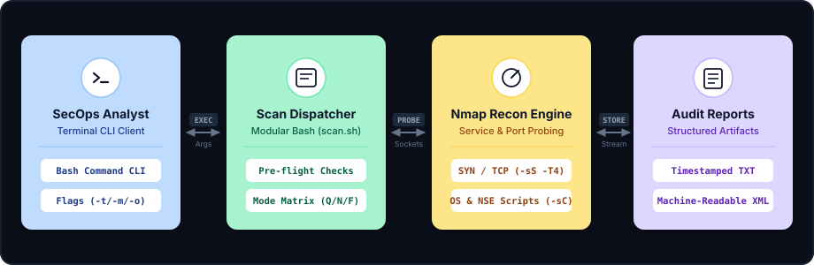

# System Architecture
### Automated Network Reconnaissance Tool — Topology, Script Dispatch Pipeline, and Technical Specifications

<div align="center">
  
</div>

This document describes the architectural flow, component relationships, execution pipelines, and design decisions governing the **Automated Network Reconnaissance Tool**.

---

### 1. High-Level Architecture Flow

The tool employs a decoupled execution pipeline separating command-line argument validation, pre-flight environment checks, Nmap socket orchestration, and structured file persistence:

<p align="center" style="margin: 20px 0;">
  
</p>

```
+------------------------------------------------------------------------------------------------------------------------+
|                                    Automated Network Reconnaissance Architecture Flow                                  |
+--------------------------+          +-------------------------+          +-----------------------+          +----------+
|  SecOps Analyst          |   EXEC   |  Scan Dispatcher        |  PROBE   |   Nmap Recon Engine   |  STORE   |Structured|
|  (Terminal CLI Client)   | <======> |  (Modular Bash scan.sh) | <======> |   (Raw Sockets & NSE) | <======> |Audit Log |
|  - Flags (-t / -m / -o)  |   Args   |  - Pre-flight & Modes   | Sockets  |   - SYN/TCP, OS & NSE |  Stream  |TXT & XML |
+--------------------------+          +-------------------------+          +-----------------------+          +----------+
```

---

### 2. Core Architectural Subsystems

#### 2.1 CLI Interface & Argument Parsing Layer
- **POSIX Argument Evaluator:** Processes short (`-t`, `-m`, `-o`, `-h`) and long (`--target`, `--mode`, `--output`, `--help`) CLI options.
- **Input Sanitization & Normalization:** Validates target strings against IP regex patterns or hostname formats, preventing arbitrary command injection.
- **Help Subsystem:** Provides immediate terminal usage documentation and real-world invocation examples.

#### 2.2 Pre-Flight & Environment Subsystem
- **Dependency Verifier:** Checks for the presence of the `nmap` binary in the system `$PATH` using `command -v nmap`.
- **Privilege Evaluator:** Inspects user permissions (UID 0 vs non-root) to warn or adapt scan types that require raw socket privileges (e.g., SYN `-sS` and OS detection `-O`).
- **File System Initialization:** Pre-allocates unique timestamped output file paths to prevent accidental overwrites.

#### 2.3 Scan Mode Orchestration Engine
- **Quick Mode Pipeline:** Configured with `-F -T4` (fast scan of top 100 ports with aggressive timing) for rapid host verification.
- **Normal Mode Pipeline:** Executes host discovery ping sweep (`-sn`), followed by top 1,000 TCP port scan and service banner grabbing (`-sV`).
- **Full Mode Pipeline:** Comprehensive 65,535-port interrogation (`-p-`), OS detection (`-O`), aggressive service version discovery (`-sV`), and default NSE vulnerability scripts (`-sC`).

#### 2.4 Output Streaming & Reporting Pipeline
- **Dual-Stream Redirection:** Utilizes GNU `tee` with append flag (`-a`) to provide zero-latency terminal feedback while simultaneously creating an immutable log record.
- **Structured XML Generation:** When requested via `-o xml`, invokes Nmap's native `-oX` flag to produce schema-compliant XML suitable for automated SIEM pipelines or Python ETL parsers.

---

### 3. Scan Mode Specifications Matrix

| Mode Flag | Port Scope | Timing | Probe Types | Flags Utilized | Primary Use Case |
|---|---|---|---|---|---|
| `quick` | Top 100 Ports | `-T4` | TCP SYN / Connect | `-F -T4` | Rapid alive-host triage |
| `normal` | Top 1,000 Ports | `-T3` | ICMP + TCP + Banners | `-sn`, `-sV` | Standard infrastructure audit |
| `full` | All 65,535 Ports | `-T4` | TCP SYN + OS + NSE | `-p- -sV -O -sC` | Deep perimeter vulnerability audit |

---

### 4. Architectural Decision Records (ADRs)

#### ADR-01: Native GNU Bash Implementation
- **Context:** Reconnaissance tools are frequently deployed in ephemeral containers, cloud bastions, and air-gapped jump hosts where Python runtimes or virtual environments may not exist.
- **Decision:** Implement the orchestration pipeline purely in POSIX-compliant GNU Bash.
- **Consequences:** Eliminates external runtime dependencies; executes instantly on any Unix/Linux environment where standard `nmap` is present.

#### ADR-02: Simultaneous Dual-Stream Output via `tee`
- **Context:** Security operators need live visibility during long-running scans, while automated compliance pipelines require complete log files.
- **Decision:** Route all probe outputs through `tee -a $filename`.
- **Consequences:** Ensures non-blocking terminal visualization without buffering delays while guaranteeing persistent audit logs on disk.

#### ADR-03: Modular Script Organization
- **Context:** Maintainability and ease of test automation.
- **Decision:** Encapsulate execution modes into discrete Bash functions (`run_quick_scan`, `run_normal_scan`, `run_full_scan`).
- **Consequences:** Clean separation of concerns allowing individual modes to be tested, enhanced, or extended independently.
