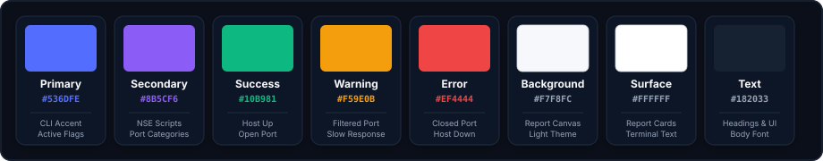

# Design System & CLI Specifications
### Automated Network Reconnaissance Tool — Terminal Aesthetics, Color Palette, and Telemetry Layouts

<div align="center">
  
</div>

This document details the visual identity, CLI terminal styling, color tokens, and output formatting guidelines for the **Automated Network Reconnaissance Tool**.

---

### 1. Design Principles

The design of the command-line interface balances rapid terminal legibility with clean, unambiguous security telemetry:

<p align="center" style="margin: 20px 0;">
  
</p>

- **User-Centered:** Predictable argument structure, intuitive flags, and immediate help banners.
- **Minimal & Clean:** Zero runtime bloat, fast startup, and crisp terminal output without extraneous noise.
- **Consistent:** Standardized timing templates, predictable probe sequences, and uniform artifact naming.
- **Accessible:** High-contrast terminal color codes, clean ASCII dividers, and standard XML exports.

---

### 2. Color Palette & Terminal Tokens

The tool employs an 8-color design system engineered for terminal emulators, reports, and audit artifacts:

<p align="center" style="margin: 20px 0;">
  
</p>

#### Color Specifications & Semantic Tokens

| Swatch | Name | Hex Code | Terminal ANSI | Application |
|---|---|---|---|---|
| <span style="background-color:#536DFE;color:#FFFFFF;padding:2px 8px;border-radius:4px;font-weight:bold;">Primary</span> | Primary Blue | `#536DFE` | `\033[1;34m` | Active flags, tool banners, highlighted prompts |
| <span style="background-color:#8B5CF6;color:#FFFFFF;padding:2px 8px;border-radius:4px;font-weight:bold;">Secondary</span> | Secondary Purple | `#8B5CF6` | `\033[1;35m` | NSE script categories, version banners |
| <span style="background-color:#10B981;color:#FFFFFF;padding:2px 8px;border-radius:4px;font-weight:bold;">Success</span> | Success Green | `#10B981` | `\033[1;32m` | Open ports, responsive hosts, completed scan alerts |
| <span style="background-color:#F59E0B;color:#000000;padding:2px 8px;border-radius:4px;font-weight:bold;">Warning</span> | Warning Amber | `#F59E0B` | `\033[1;33m` | Filtered ports, slow network alerts, missing root warnings |
| <span style="background-color:#EF4444;color:#FFFFFF;padding:2px 8px;border-radius:4px;font-weight:bold;">Error</span> | Error Red | `#EF4444` | `\033[1;31m` | Closed ports, host unreachable, invalid target arguments |
| <span style="background-color:#F7F8FC;color:#182033;padding:2px 8px;border-radius:4px;font-weight:bold;border:1px solid #CBD5E1;">Background</span> | Canvas Background | `#F7F8FC` | — | Light theme report background, HTML export canvas |
| <span style="background-color:#FFFFFF;color:#182033;padding:2px 8px;border-radius:4px;font-weight:bold;border:1px solid #CBD5E1;">Surface</span> | Surface Card | `#FFFFFF` | — | Document card surface, terminal text highlights |
| <span style="background-color:#182033;color:#FFFFFF;padding:2px 8px;border-radius:4px;font-weight:bold;">Text</span> | Text Primary | `#182033` | `\033[0;37m` | Primary terminal body copy, command descriptions |

---

### 3. Typography & Monospace Formatting

The tool's terminal output is optimized for high-readability monospace fonts (**JetBrains Mono**, **Fira Code**, or **Consolas**):

```
Terminal Monospace Hierarchy
├── ASCII Header:      72-character wide boxed title banner
├── Section Title:     Bold uppercase text prefixed with "====" dividers
├── Status Prompt:     "[+]" (Success), "[*]" (Info), "[!]" (Warning), "[-]" (Error)
├── Port Telemetry:    Right-aligned port/protocol, state, service, version
└── Footer:            Elapsed timing summary and saved file location path
```

---

### 4. Terminal Banner & Output Patterns

#### 4.1 CLI Banner Presentation
```
=============================================================
           AUTOMATED NETWORK RECONNAISSANCE TOOL             
                Using Nmap and Bash Scripting                
=============================================================
```

#### 4.2 Formatted Status Output
```
[*] Target Specified:  192.168.1.1
[*] Scan Mode:         quick (Top 100 ports, -F -T4)
[*] Output File:       scan_192.168.1.1_20261031.txt

[+] Host is alive (0.0024s latency)
[+] Discovered Open Ports:
    22/tcp   open   ssh       OpenSSH 8.9p1
    80/tcp   open   http      Apache httpd 2.4.52
    443/tcp  open   ssl/http  Apache httpd 2.4.52

[+] Scan complete. Output saved to: scan_192.168.1.1_20261031.txt
```

---

### 5. Structured Output Specifications

When `-o xml` is supplied, Nmap generates well-formed XML:
```xml
<?xml version="1.0" encoding="UTF-8"?>
<!DOCTYPE nmaprun>
<nmaprun scanner="nmap" args="nmap -F -T4 192.168.1.1" start="1793433600">
  <host>
    <status state="up" reason="arp-response"/>
    <address addr="192.168.1.1" addrtype="ipv4"/>
    <ports>
      <port protocol="tcp" portid="22"><state state="open"/><service name="ssh"/></port>
      <port protocol="tcp" portid="80"><state state="open"/><service name="http"/></port>
    </ports>
  </host>
</nmaprun>
```
This structured XML enables ingestion into tools like Splunk, ELK, Nessus, or custom Python analytics dashboards.

